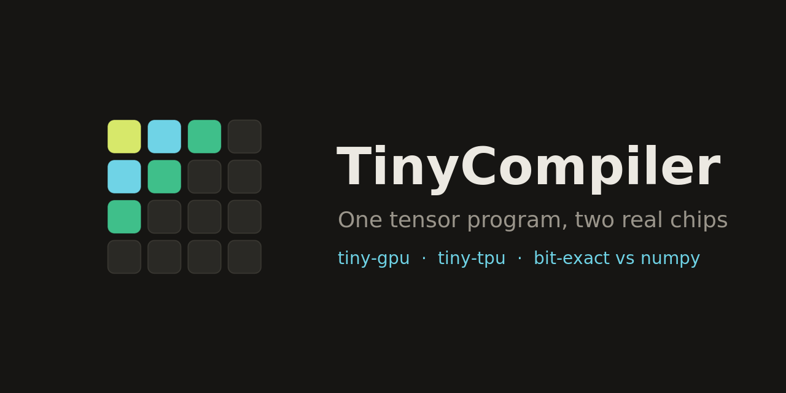
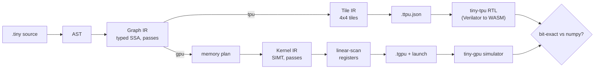

<div align="center">
  

  <h1>TinyCompiler</h1>

  <p>
    <strong>A tiny tensor compiler that targets a real GPU simulator and a real systolic-array TPU,<br>
    and checks every result bit-exact against numpy.</strong>
  </p>

  <p>
    <a href="https://tiny-compiler.vercel.app"></a>
    <a href="https://github.com/tinycomputers/tiny-compiler/actions/workflows/py.yml"></a>
    <a href="https://github.com/tinycomputers/tiny-compiler/actions/workflows/web.yml"></a>
    <a href="LICENSE"></a>
    
    
  </p>
</div>



TinyCompiler takes one small tensor program, such as `C = relu(A @ B)`, and compiles it to two
very different chips. It produces **tiny-gpu** SIMT assembly that runs on a cycle-level GPU
simulator, and a **tiny-tpu** tile schedule that runs on a real SystemVerilog systolic array
(simulated through Verilator and WebAssembly). Each result is checked against a numpy oracle, so
you can see the same program run on two architectures and get the same answer.

It is built to be read. Every compiler stage has a printer, a verifier, and an interpreter, and
you can watch the IR change one pass at a time. The whole thing also runs in your browser at the
[Compiler Explorer](https://tiny-compiler.vercel.app/app).

```text
$ tinyc examples/mm_relu.tiny --target gpu --run -O2
%1 =
[[16161 15523     0  2949]
 [    0  8580  1770 15819]
 [    0 10549  1568  5105]
 [    0  9847  5002     0]]
bit-exact vs numpy oracle: yes
launches: 1  threads: 16  registers: 5  (R5-R7 untouched: yes)
measured cycles: 3  (estimate 2..3)
measured instructions: 885  (estimate 880..896)
measured loads: 160 (estimate 160)  stores: 16 (estimate 16)

$ tinyc examples/mm_relu.tiny --target tpu --run
%1 =
[[16161 15523     0  2949]
 [    0  8580  1770 15819]
 [    0 10549  1568  5105]
 [    0  9847  5002     0]]
bit-exact vs numpy oracle: yes
chip passes: 2  measured RTL cycles: 30  (estimate 30)
```

<sub>From `examples/mm_relu.tiny` (`C = relu(A @ B)`, shapes `A: i8[4,8]`, `B: i8[8,4]`).</sub>

## Contents

- [What it is](#what-it-is)
- [How it works](#how-it-works)
- [Features](#features)
- [Measured results](#measured-results)
- [Quickstart](#quickstart)
- [The language](#the-language)
- [Verification](#verification)
- [Project layout](#project-layout)
- [Related projects](#related-projects)
- [FAQ](#faq)
- [Contributing, security and license](#contributing-security-and-license)

## What it is

TinyCompiler is an **educational tensor compiler** for a tiny language with static shapes, rank
two or less, `i8` and `i32` types, matrix multiplication (`@`), row broadcast (`+`), and `relu`.
It is a small, complete example of the path a deep-learning compiler takes: parse, build a typed
graph IR, optimize with a pass pipeline, lower to hardware-shaped IR, allocate registers or tiles,
and emit machine code. It is small enough to read end to end in an afternoon.

It targets two chips built as learning projects:

| Target | Chip | What it runs on | What the compiler emits |
|---|---|---|---|
| **tiny-gpu** | a SIMT GPU simulator with per-thread registers, shared memory, and barriers | the cycle-level Python simulator | `.tgpu` assembly and a launch description |
| **tiny-tpu** | a 4×4 int8 systolic array in SystemVerilog | the real RTL, through Verilator compiled to WebAssembly | `.ttpu.json` tile schedules |

## How it works



Each stage has a printer, a verifier, and an interpreter. `--print-after-all` shows the IR after
every pass, and `--verify-each` re-checks the program against the oracle after every pass.

## Features

- **Two real chips, one source.** The same program compiles to tiny-gpu kernels and to a tiny-tpu
  tile schedule. Both run on their own simulator or RTL.
- **Bit-exact checking.** Every run is compared with a numpy oracle computed from the source
  program, not from the compiler's own output.
- **Optimization levels that show their work.** `-O0` is the naive lowering. `-O1` adds loop-invariant
  code motion, strength reduction and dead-code elimination. `-O2` adds shared-memory tiling, loop
  unrolling and folding. Each pass can be turned off by name (`--disable licm`) to see what it buys.
- **Range proofs.** A `range-check` pass proves every value fits in `i32` before any code runs,
  and rejects the program otherwise.
- **Source-accurate errors.** Diagnostics point at the exact column, with a caret. Twenty of them are
  pinned in golden tests.
- **In the browser.** The [Compiler Explorer](https://tiny-compiler.vercel.app/app) compiles with
  Python running in Pyodide, runs the tiny-gpu simulator, plays the tiny-tpu array cycle by cycle, and
  replays each compiler pass with a fade. Light and dark themes, and it works on a phone.
- **Verified the hard way.** Differential fuzzing: random programs run through every backend and
  level on the real chips. See [Verification](#verification).

## Measured results

The table is generated from real simulator runs by `scripts/opt_table.py`. A test fails if these
numbers drift from what the compiler actually produces.

**8×8 matmul with relu** (`C = relu(A @ B)`, int8, seed 42), tiny-gpu:

| configuration | instructions | cycles | global loads | shared loads | registers |
|---|---:|---:|---:|---:|---:|
| -O0 (naive) | 7320 | 10 | 1088 | 0 | 4 |
| + licm | 6168 (-16%) | 9 | 1024 (-6%) | 0 | 5 |
| + strength-reduce (= -O1) | 5208 (-29%) | 9 | 1024 (-6%) | 0 | 6 |
| -O2 with shared-memory tiling only | 4952 (-32%) | 10 | 576 (-47%) | 512 | 5 |
| -O2 with unrolling + folding only | 3544 (-52%) | 2 | 1024 (-6%) | 0 | 7 |
| **-O2 (all passes)** | **3288 (-55%)** | **3** | **576 (-47%)** | 512 | 5 |

Shared-memory tiling halves the global memory traffic and unrolling cuts the cycle count. The full
per-pass explanation, including why `-O2` is not simply better in every column, is in
[docs/ARCHITECTURE.md](docs/ARCHITECTURE.md).

On tiny-tpu, every matmul costs `15` RTL cycles per 4×4 pass. The compiler's cost model equals the
measured RTL cycles exactly, and a test pins that.

## Quickstart

You need Python 3.12 and Node 20 or newer (the TPU executor runs under Node).

```bash
git clone --recurse-submodules https://github.com/tinycomputers/tiny-compiler.git
cd tiny-compiler
python3 -m venv .venv && .venv/bin/pip install -e ".[dev]" && .venv/bin/pip install -e targets/tiny-gpu --no-deps
source scripts/env.sh
```

Run an example on each chip:

```bash
tinyc examples/mm_relu.tiny --target gpu --run -O2   # tiny-gpu simulator
tinyc examples/mm_relu.tiny --target tpu --run       # tiny-tpu RTL
tinyc examples/mlp_gpu.tiny --target gpu --run       # two layers: tiny-tpu rejects it, tiny-gpu runs it
```

Look inside the compiler:

```bash
tinyc examples/mm_bias_relu.tiny --locs --print-after-all   # the Graph IR after every pass
tinyc examples/mm_relu.tiny --target gpu --emit tgpu -O2    # the tiny-gpu assembly
tinyc examples/mm_relu.tiny --target tpu --emit ttpu        # the tile schedule as JSON
```

Run the tests:

```bash
pytest -q
cd web && pnpm install && pnpm test && pnpm e2e
```

Or skip the install entirely and use the [Compiler Explorer](https://tiny-compiler.vercel.app/app).

## The language

```text
# examples/mm_bias_relu.tiny: a dense layer, matmul, row-broadcast bias, relu
input X : i8[4, 8]
input W : i8[8, 4]
input b : i32[4]
Y = relu(X @ W + b)
output Y
```

Shapes are static, rank is at most two, and everything is integer. That keeps the semantics exact,
so the numpy oracle and the chips can agree bit for bit. The full reference is in
[docs/LANGUAGE.md](docs/LANGUAGE.md).

## Verification

Every claim the compiler makes is checked against something independent.

| Layer | What it checks | Count or result |
|---|---|---|
| Oracle | numpy evaluation of the source program | every example, every run |
| Real targets | the emitted assembly and tile schedules run on the simulator and the RTL | bit-exact on all examples |
| Per-pass validation | `--verify-each` re-checks the oracle after every pass | every optimization level |
| Differential fuzzing | random programs through every backend and level on the real chips | 5,000 + 5,000 programs, no failures |
| Regression corpus | corner cases and past bugs, replayed on every backend | 13 programs |
| Contract tests | the facts about each chip that the compiler depends on are measured and pinned | `tests/test_targets_contract.py` |
| Pinned numbers | cycle and load counts per example and level | `tests/perf_baseline.json` |
| Browser end-to-end | the Compiler Explorer compiles, runs and renders in Chromium | 9 Playwright tests |

Details, including the bugs the verification found, are in [docs/VERIFICATION.md](docs/VERIFICATION.md).

## Project layout

```text
tinyc/          the compiler: frontend, graph passes, tpu/ and gpu/ backends
runtime/        runners for both chips, and the browser entry point (web_api.py)
examples/       .tiny programs used by the tests and the Explorer
tests/          pytest suite: goldens, properties, fuzzing, regressions
scripts/        build_web.py (browser bundle), opt_table.py (measured table)
docs/           language, IR, pass, backend and verification documentation
web/            the Compiler Explorer and the docs site (Astro, React, Pyodide)
targets/        tiny-gpu and tiny-tpu, as git submodules
```

## Related projects

- **[tiny-gpu](https://github.com/tinycomputers/tiny-gpu)**: the SIMT GPU simulator that TinyCompiler targets.
- **[tiny-tpu](https://github.com/tinycomputers/tiny-tpu)**: the systolic-array TPU, in SystemVerilog, that TinyCompiler targets.

## FAQ

**Does it run on real GPU or TPU hardware?**
No. It runs on the tiny-gpu Python simulator and on the tiny-tpu RTL compiled with Verilator. Both
are educational models, so the cycle counts describe those models, not a real accelerator.

**What is a systolic array?**
A grid of multiply-accumulate cells where data flows through the array in waves, so each value is
read from memory once. tiny-tpu is a 4×4 one, and the Explorer shows it cycle by cycle.

**Why int8 and i32 only?**
Integer arithmetic makes every result exact, so the numpy check can be bit-for-bit. Floats would need
a tolerance and would hide real bugs.

**Can I add an operator?**
Yes. Add it to the frontend and the graph IR, then lower it on each backend. The tests tell you
which layers still need the new case.

**Is this a production compiler?**
No. It is a teaching and research project. It is small and readable on purpose, and it is verified
carefully, but it is not a replacement for XLA, TVM or MLIR.

## Contributing, security and license

Contributions are welcome. Read [CONTRIBUTING.md](CONTRIBUTING.md) first. To report a security
problem, see [SECURITY.md](SECURITY.md) and use GitHub's private reporting, not a public issue.

Released under the [MIT License](LICENSE).
